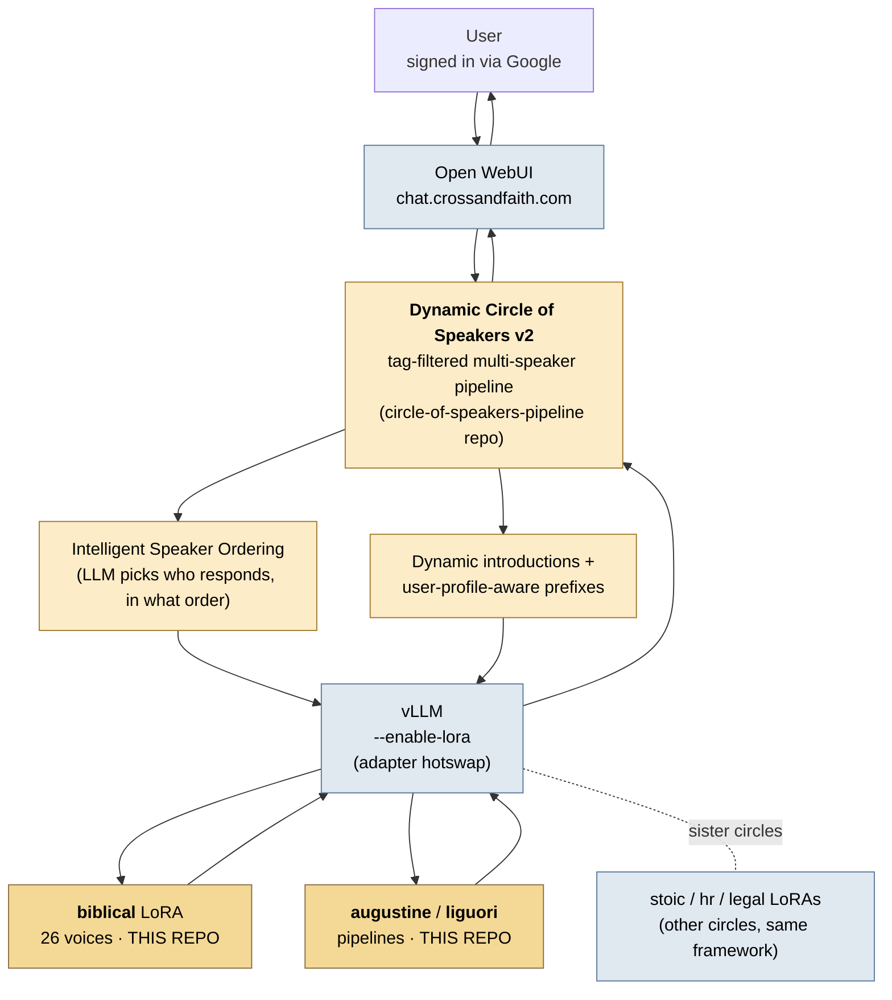
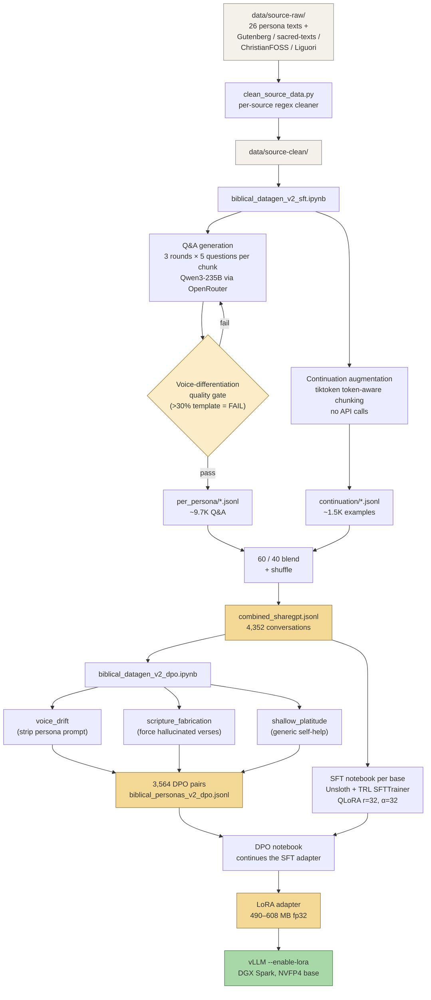

# Biblical Persona LoRA — Multi-Voice Scripture Fine-Tuning


## 🚀 Live in Production

> **The LoRA is deployed and publicly available at [chat.crossandfaith.com](https://chat.crossandfaith.com)** (Google sign-in) — landing page at **[crossandfaith.com](https://www.crossandfaith.com)**.

This is **not a research artifact**. It is a working multi-tenant deployment with real Google OAuth sign-up, production sampling, and months of real user conversations. The trained LoRA is hot-attached to **vLLM** behind **Open WebUI**, so users can pick the `biblical` model directly or use Open WebUI's compare-models feature to A/B against the bare base model on the same prompt.

The adapter in production today is `biblical_dpo`, trained on **Qwen3.8-27B** and served over an NVFP4 quantization of the same base on an NVIDIA DGX Spark. The pipeline has been retrained on seven base models since the first Qwen3-14B release; see [Base models and shipped adapters](#base-models-and-shipped-adapters).

> Side-by-side example from the production UI on the same prompt this README documents — the `biblical` LoRA gives Pauline first-person testimony ("*I have seen the Lord, and by His grace I bear witness...*") while base `Qwen3-14b` gives an encyclopedia-style answer ("*The early apostolic communities, particularly those described in the New Testament...*"). Full text in [`docs/comparisons/early-apostolic-communities.md`](docs/comparisons/early-apostolic-communities.md).

---

## How the LoRA reaches users — two-layer architecture

This repo is **the model-layer half** of the production system. The runtime layer that orchestrates multi-persona conversations on top of these adapters is the open-source [Circle of Speakers pipeline](https://github.com/beaudamore/circle-of-speakers-pipeline).

Each persona LoRA is registered as a tagged Open WebUI model (`biblical`, `stoic`, etc.). The **Dynamic Circle of Speakers v2** pipeline filters the model registry by tag, picks which speaker(s) should respond next via an **intelligent speaker-ordering model**, injects per-speaker introduction and user-profile-aware prefixes, and streams responses back through Open WebUI.



| Layer | What it is | Where it lives |
| --- | --- | --- |
| **Model layer** | Trained LoRA adapters + data + training pipeline that produced them | **This repo** |
| **Runtime layer** | **Dynamic Circle of Speakers v2** — multi-speaker Open WebUI pipeline with tag-filtered speaker selection, intelligent-ordering model for turn-taking, dynamic per-speaker introductions, user-profile-aware response prefixes, and streaming vLLM passthrough. Same framework powers sister circles for `stoic`, `hr`, `legal` domains. | [circle-of-speakers-pipeline](https://github.com/beaudamore/circle-of-speakers-pipeline) · [writeup at damore.ai](https://www.damore.ai/blog/dynamic-circle-of-speakers-v2) |
| **Surface layer** | Open WebUI UI: model picker, side-by-side compare, Google OAuth, per-speaker profile images served from `images.crossandfaith.com` | [chat.crossandfaith.com](https://chat.crossandfaith.com) |
| **Inference layer** | vLLM with `--enable-lora` for hot-swap between adapters at request time. Today: Qwen3.8-27B NVFP4 on the DGX Spark serving `biblical_dpo` alongside the safety-classifier adapters. Reference compose files per base model in [`compose/`](compose/). | OSS dependency |

The framework is **persona-agnostic** — the biblical adapters from this repo plug into the same pipeline that runs the stoic, HR, and legal circles. The model layer (this repo) and the runtime layer (Circle of Speakers) are intentionally decoupled so additional persona families can be added without touching the orchestrator. A dedicated cast-selection LoRA to replace the ordering model's prompt-only routing is designed in the orchestration-selector project.

More technical writeups at **[damore.ai/blog](https://www.damore.ai/blog)**.

---

## What it is

A two-stage **QLoRA** fine-tune (SFT, then DPO continuing the same adapter) that teaches a base model to speak in **26 distinct biblical voices**, with separate pipelines for **Augustine** and **Alphonsus de Liguori**. First built on **Qwen3-14B**, since retrained on Qwen3.5-27B, Qwen3.6-27B, **Qwen3.8-27B** (production), Qwen3.5-4B and Gemma 4 (12B, E2B, E4B) for mobile. Built on **Unsloth** with 4-bit quantization and trained on an NVIDIA **DGX Spark** (128 GB unified memory).

The pipeline pairs **persona-conditioned Q&A generation** (with a voice-differentiation quality gate that fails closed on >30% template contamination) with **raw-text continuation augmentation** to teach prose cadence, then layers a **DPO** dataset across **three engineered rejection strategies** — voice drift, scripture fabrication, and shallow platitude. Includes a regex-based per-source data-cleaning pipeline, deployment notes, and an **LLM-as-judge** evaluation showing the LoRA scoring **+12** over the base model on a 6-dimension voice-fidelity rubric.

> 📄 **[See the side-by-side LoRA-vs-base comparison (PDF) →](docs/comparisons/early-apostolic-communities.pdf)**
> The same prompt sent to base Qwen3-14B and to the LoRA. Scoring rubric and rationale per dimension.

When you ask **Paul** a question, he builds long theological chains with autobiographical anchors (Damascus road, his thorn, his shipwrecks). Ask **Amos** the same question — you get a blunt one-liner with a farming metaphor. Ask **David** — psalm-cadence parallelism and raw emotional vulnerability. The voice switches based on the system prompt; the model learns to switch with it.

---

## Skills Demonstrated

| Domain | Specifics |
| --- | --- |
| **Fine-tuning / PEFT** | LoRA, QLoRA (4-bit NF4), `r=32 / α=32` across all 7 attn+MLP projections, TRL `SFTTrainer` + `DPOTrainer` continuing one adapter, gradient accumulation, pre-packed sequences (handling the `packing=False` interaction with TRL); the same recipe carried across Qwen3, Qwen3.5/3.6/3.8 and Gemma 4 bases |
| **Multimodal base handling** | Qwen3.5+ and Gemma 4 ship vision/audio towers and MTP heads. The adapters are scoped to the language model with `finetune_vision_layers=False` and an assertion that nothing else was adapted; every saved adapter is audited from its safetensors keys before serving |
| **Synthetic-data generation** | Persona-conditioned Q&A with KJV exemplar grounding; banned-opener retry loop; cross-persona 4-gram opener uniqueness gate; three rejection-strategy DPO with per-persona caps |
| **Data engineering** | Per-source regex cleaner (Project Gutenberg / sacred-texts.com / ChristianFOSS / Liguori imprimaturs); sentence-aware chunking (pySBD); `tiktoken` token-aware chunking for continuation tasks; ShareGPT format |
| **Evaluation** | LLM-as-judge with 6-dimension rubric; voice-differentiation quality gate; cold-reload adapter sanity check; per-persona contamination metrics |
| **Infra / Ops** | NGC PyTorch container debugging on aarch64 (`causal_conv1d` source-build with `CAUSAL_CONV1D_FORCE_BUILD=TRUE`); strict Unsloth import-order discipline; unified-memory discipline on GB10; vLLM LoRA hot-attach over NVFP4 and FP8 bases; GGUF export for on-device models |
| **Production deployment** | **Live multi-tenant chat** at [chat.crossandfaith.com](https://chat.crossandfaith.com); Open WebUI surface; Google OAuth sign-up; vLLM serving with `--enable-lora`; months of real user traffic |
| **Tooling built** | OpenAI-compatible API generation (OpenRouter / local vLLM swap); reproducible `regenerate.sh` for evaluation PDFs; per-base-model vLLM compose files; workspace-wide adapter audit script |

---

## Headline Numbers

| Item | Value |
| --- | --- |
| **Personas** | 26 (KJV-grounded) + Augustine + Liguori pipelines |
| **SFT examples** | 4,352 ShareGPT conversations (2,612 Q&A + continuation) → 1,535 packed 4096-tok chunks on the 14B run |
| **SFT blend** | 60% Q&A / 40% raw-text continuation |
| **DPO pairs** | 3,564 across 3 engineered rejection strategies |
| **Augustine / Liguori sets** | 2,726 / 844 ShareGPT conversations |
| **Source corpus** | KJV per-persona texts + Project Gutenberg + sacred-texts.com + ChristianFOSS |
| **Generator model (Q&A)** | Qwen3-235B-A22B-2507 (OpenRouter); Qwen-2.5-7B for cheap rejected answers in DPO |
| **Production base model** | `unsloth/Qwen3.8-27B` (training) → `RadixArk/Qwen3.8-27B-NVFP4` (serving) |
| **Adapter shape** | LoRA r=32 / α=32 across all 7 attn+MLP projections; 128 M trainable params (0.86%) on 14B, 608 MB fp32 on the 27B bases |
| **Training hardware** | NVIDIA DGX Spark (GB10 superchip, 128 GB unified) |
| **Documented run (14B v2)** | ~2 h 39 min wall-clock; 192 steps; final loss **1.31** |

---

## Base models and shipped adapters

Every base below has a completed SFT adapter; all but the two smallest Gemma mobile builds
also have a DPO adapter that continues it. Values are read from each run's `adapter_config.json`
and `trainer_state.json`, not from the notebooks. Adapters live under `output/` (gitignored).

| Base model | SFT date | SFT steps · loss (first → last) | DPO date · steps | r / α | Notes |
| --- | --- | --- | --- | --- | --- |
| `unsloth/Qwen3-14B-unsloth-bnb-4bit` (v2) | 2026-06-13 | 192 · final 1.31 | 2026-06-13 · 446 | 32 / 32 | The documented run below; LLM-judge comparison |
| `cyberenchanter/Qwen3.5-27B-bnb-4bit` | 2026-06-12 | 195 · 1.77 → 1.10 | 2026-06-13 · 446 | 16 / 16 | First 27B |
| `unsloth/Qwen3.6-27B` | 2026-07-29 | 544 · 1.58 → 1.24 | 2026-07-29 · 446 | 32 / 32 | Served on the Qwen3.6 NVFP4 stack until the 3.8 move |
| **`unsloth/Qwen3.8-27B`** | 2026-08-15 | 544 · 1.71 → 1.36 | 2026-08-15 · 446 | 32 / 32 | **Production** (`biblical_dpo`) |
| `unsloth/Qwen3.5-4B` | 2026-08-29 | 544 · 2.14 → 1.69 | 2026-08-31 · 446 | 32 / 32 | Small/mobile; GGUF exported |
| `unsloth/gemma-4-12b-it` | 2026-07-21 | 544 · 1.08 → 0.35 | 2026-07-21 · 446 | 32 / 32 | |
| `unsloth/gemma-4-E4B-it-unsloth-bnb-4bit` | 2026-04-23 | 327 · 0.91 → 0.40 | — | 32 / 32 | Mobile; GGUF exported |
| `unsloth/gemma-4-E2B-it-unsloth-bnb-4bit` (v2) | 2026-05-01 | 544 · 1.15 → 0.42 | — | 32 / 32 | Mobile; GGUF exported |

Steps differ (192 vs 544) because the 14B run trained on pre-packed 4096-token chunks and the
later runs on unpacked conversations at the same effective batch of 8. DPO losses are not
listed; all DPO runs are one epoch over the 3,564 pairs at 446 steps.

---

## Results

### Training run (Qwen3-14B v2)

| Metric | Value |
| --- | --- |
| Final training loss | **1.31** |
| Wall-clock | 9,547 s = **2 h 39 min** on a single GB10 |
| Total steps | 192 (1 epoch) over 1,535 packed 4096-tok chunks |
| Effective batch size | 8 (per-device 2 × grad-accum 4) |
| Trainable params | 128,450,560 / 14,896,757,760 (**0.86%**) |
| Optimizer | `adamw_8bit` |
| Precision | bf16 (Unsloth padding-free auto-enabled) |
| Adapter size | 490 MB safetensors (fp32 weights; can shrink to ~245 MB bf16 if needed) |

The Qwen3.8-27B production run uses the same recipe at `MAX_SEQ_LENGTH = 3072`, LR 2e-4,
batch 2 × grad-accum 4, r=32 / α=32, with the vision tower frozen explicitly.

### Dataset composition (post-pack)

```text
Total examples: 4,352   |   26 personas   |   Turn distribution: {3-turn: 1,741  5-turn: 91  7-turn: 541  9-turn: 1,979}
```

Top → bottom by persona representation (the user is aware of imbalance — DPO uses a per-persona cap of 80/source to compensate):

```text
moses        785  ███████████████▌      |  apostle_john  71  █
jeremiah     381  ███████▌              |  james         54  █
paul         377  ███████▌              |  malachi       44  ▌
david        350  ███████               |  joel          44  ▌
ezekiel      341  ██████▌               |  zephaniah     37  ▌
isaiah       332  ██████▌               |  habakkuk      32  ▌
solomon      254  █████                 |  jonah         29  ▌
job          244  ████▌                 |  nahum         27  ▌
daniel       239  ████▌                 |  haggai        24
peter        148  ██▌                   |  obadiah       19
zechariah    145  ██▌                   |  jude          15
hosea        107  ██                    |
amos          92  █▌                    |
joshua        88  █▌                    |
micah         73  █                     |
```

### Voice samples (LoRA outputs, persona system prompt only — no question-priming)

- **Daniel** — *"Four is the number that stays with me — not counted among kings' decrees nor written in astrologers' tablets..."*
- **Job** — *"There was a time when I counted my children in their feasts, seven sons and three daughters beneath..."*
- **David** — *"O LORD, how long shall the sons of Belial rise like smoke from a cursed altar, filling the courts of..."*
- **Micah** — *"A shepherd does not leave the fold scattered just to prove his strength — he gathers the sheep not by..."*

### Cold-reload sanity check

The training notebook's final cell wipes the in-memory model, reloads the adapter from disk, and re-runs inference — catching the surprisingly common "training succeeded but the saved adapter is corrupted" failure mode in 4-bit + PEFT pipelines.

```text
✓ Cleared training model from memory
  Loading adapter from: lora_adapters/
ADAPTER RELOAD TEST (persona: daniel):
  Q: I am struggling with forgiveness. What does Scripture teach about forgiving others?
  A: In the third year of King Belshazzar's reign, I saw a vision by night:
     a man with eyes like flames of fire stood beside the river Hiddekel...
✓ Adapter loads cleanly from disk. Ready for deployment via vLLM.
```

### LLM-as-judge head-to-head (LoRA vs base Qwen3-14B)

📄 **[Full PDF with rubric and per-dimension rationale →](docs/comparisons/early-apostolic-communities.pdf)**

| Dimension | Base | LoRA | Δ |
| --- | --- | --- | --- |
| Persona voice fidelity | 1 | 5 | **+4** |
| Cadence / Biblical register | 1 | 5 | **+4** |
| First-person testimony | 1 | 5 | **+4** |
| Specificity & concrete imagery | 2 | 4 | **+2** |
| Citation handling | 4 | 3 | −1 |
| Information completeness | 5 | 4 | −1 |
| **Total** | **14** | **26** | **+12** |

The two negative dimensions are intentional trade-offs: chapter-and-verse citation conventions and exhaustive sacrament enumeration are *anti-Pauline* behaviors. The LoRA correctly sheds them in favor of voice authenticity.

---

## Repo Layout

```text
biblical/
├── README.md                       ← you are here
├── docs/
│   ├── data-pipeline.md            How raw texts are cleaned & chunked
│   ├── sft-data-generation.md      Q&A generation + voice-quality gate + continuation
│   ├── dpo-data-generation.md      Three rejection strategies for preference pairs
│   ├── training.md                 Unsloth + QLoRA training config (14B v2 run)
│   ├── biblical-lora-v1-v2-overview.md   Why v2 was added (Q&A → Q&A + raw text)
│   ├── augmentation-roadmap.md     Corpus audit + planned augmentations (2026-08)
│   ├── comparisons/                LoRA-vs-base comparison (md, html, pdf) + regenerate.sh
│   └── screenshots/
├── compose/                        vLLM reference compose files per serving base:
│                                   qwen_3_8_nvfp4 (production), qwen_3_8_fp8, qwen_3_6_nvfp4, qwen_3_5_4b_nvfp4
├── prompts/                        Hand-written persona system prompts (Paul, Augustine, Adam-and-Eve, Simon the Zealot)
├── data/                           (gitignored: regenerated locally)
│   ├── source-raw/                 Untouched originals (Gutenberg, sacred-texts, 15 Bible translations, etc.)
│   ├── source-clean/               Stripped: nav boilerplate, Imprimaturs, page markers
│   ├── source-clean/full_biblical_data/   The 26 per-persona KJV concatenations
│   ├── scripts/clean_source_data.py       Source-aware cleaner (regex, no NLTK needed)
│   └── training-data/
│       ├── biblical_persona_v2/    The 26-persona dataset
│       │   ├── per_persona/<persona>.jsonl     Pre-blend Q&A (one file per voice)
│       │   ├── biblical_personas_sharegpt.jsonl        Q&A only (2,612)
│       │   ├── augmented/continuation/*.jsonl          Raw-text completion tasks
│       │   ├── biblical_personas_combined_sharegpt.jsonl   Final SFT mix (4,352)
│       │   ├── biblical_dpo_pairs_raw.jsonl            Pre-gate DPO pairs
│       │   └── biblical_personas_v2_dpo.jsonl          DPO preference pairs (3,564)
│       ├── augustine_persona/      augustine_sharegpt.jsonl (2,726) + per_source/
│       └── liguori_persona/        liguori_sharegpt.jsonl (844) + per_source/
├── notebooks/
│   ├── datagen/
│   │   ├── biblical_datagen_v2_sft.ipynb      Q&A + continuation pipeline (the core)
│   │   ├── biblical_datagen_v2_dpo.ipynb      Preference pairs from SFT data
│   │   ├── biblical_datagen_augustine.ipynb   Augustine-specific datagen
│   │   ├── biblical_datagen_liguori.ipynb     Liguori-specific datagen
│   │   ├── biblical_datagen_church_tradition.ipynb    Creeds, catechism, hymns (single voice)
│   │   ├── biblical_datagen_church_fathers.ipynb      Church Fathers, voice-differentiated
│   │   ├── biblical_datagen_deuterocanonical.ipynb    Deuterocanon & pseudepigrapha personas
│   │   ├── biblical_datagen_adam_eve.ipynb            Books of Adam and Eve, narrator voice
│   │   └── biblical_datagen.ipynb             v1 datagen (kept for diffing)
│   ├── loras/
│   │   ├── qwen_38_27b/biblical_qwen3_8_27b_{sft,dpo}_unsloth_4bit.ipynb   Production run (current reference)
│   │   ├── qwen-3.5-4b/biblical_qwen3_5_4b_{sft,dpo}_unsloth_4bit.ipynb    Small/mobile run
│   │   ├── biblical_qwen3_6_27b_{instruct,dpo}_unsloth_4bit.ipynb
│   │   ├── biblical_qwen3_5_27b_{instruct,dpo}_unsloth_4bit.ipynb
│   │   ├── biblical_qwen3_14b_instruct_unsloth_4bit_v2.ipynb + _dpo_..._v2.ipynb   Documented 14B run
│   │   ├── biblical_gemma4_12b_unsloth_4bit.ipynb + _dpo_...    Gemma 4 12B
│   │   ├── biblical_gemma4_31b_{sft,dpo}_unsloth_4bit.ipynb      Written, not run
│   │   ├── biblical_gemma4_e4b_instruct_unsloth_4bit_mobile.ipynb
│   │   ├── augustine_/liguori_/church_tradition_qwen3_14b_instruct_unsloth_4bit.ipynb
│   │   └── biblical_qwen3_14b_instruct_unsloth_4bit.ipynb       v1
│   └── old/                        Earlier base-model experiments (Llama 3.1 8B/70B, Mistral, Qwen2.5)
└── output/<model_name>/{train,lora_adapters,gguf}/   (gitignored)
```

The four extra datagen notebooks (church tradition, Church Fathers, deuterocanonical,
Adam and Eve) are written against the same pipeline; their generated sets are not on disk,
so they have not fed a training run yet. Augustine and Liguori have generated data and a
14B training notebook each but no adapter on disk.

---

## Quickstart

### 1. Set the API key for data generation

```sh
export OPENROUTER_API_KEY=sk-or-...      # or put it in a .env file the notebook loads
```

The datagen notebooks read `OPENROUTER_API_KEY` from the environment (`.env` is gitignored). You can also point them at any OpenAI-compatible endpoint by editing `API_BASE_URL` / `MODEL_NAME` in the first cell.

### 2. Clean the source corpus (idempotent, safe to re-run)

```sh
python data/scripts/clean_source_data.py
```

This wipes `data/source-clean/` and rebuilds it from `data/source-raw/`, applying a per-source cleaner (Project Gutenberg headers, sacred-texts.com nav lines, Liguori `IMPRIMI POTEST` blocks, ChristianFOSS metadata sections, page markers, etc.). See [docs/data-pipeline.md](docs/data-pipeline.md).

### 3. Generate training data

Run [notebooks/datagen/biblical_datagen_v2_sft.ipynb](notebooks/datagen/biblical_datagen_v2_sft.ipynb) end-to-end. It produces:

- 26 per-persona Q&A files in `data/training-data/biblical_persona_v2/per_persona/`
- Continuation chunks in `.../augmented/continuation/`
- Combined ShareGPT file: `biblical_personas_combined_sharegpt.jsonl`

A built-in **voice-differentiation quality gate** (template-opener contamination + 4-gram opener uniqueness) runs before assembly and refuses to proceed if generic-LLM-isms exceed 30%. See [docs/sft-data-generation.md](docs/sft-data-generation.md).

For DPO data, run [notebooks/datagen/biblical_datagen_v2_dpo.ipynb](notebooks/datagen/biblical_datagen_v2_dpo.ipynb) afterwards — it samples QA triples from the combined SFT file and generates preferred/rejected pairs across three intentionally-different failure modes. See [docs/dpo-data-generation.md](docs/dpo-data-generation.md).

### 4. Train

Notebooks run in JupyterLab inside the `unsloth-notebook` container (host port 8889). Check the GPU is free first (`docker ps`; a serving container usually holds it).

The current reference pair is [notebooks/loras/qwen_38_27b/biblical_qwen3_8_27b_sft_unsloth_4bit.ipynb](notebooks/loras/qwen_38_27b/biblical_qwen3_8_27b_sft_unsloth_4bit.ipynb) followed by its `_dpo_` twin. The SFT notebook:

1. Loads `unsloth/Qwen3.8-27B` and quantizes it to NF4 on load.
2. Attaches LoRA adapters scoped to the language model: r=32, α=32, all attention + MLP projections, vision tower frozen with an assertion.
3. Trains for 1 epoch via TRL `SFTTrainer` with response-only loss masking.
4. Saves the adapter, runs a sanity-check inference and a cold-reload test.

The DPO notebook resumes that adapter and continues it with `DPOTrainer`, caching reference log-probs to disk so an interrupted run resumes. `MODEL_NAME_BASE` in the SFT notebook is the contract the DPO notebook resolves the adapter path from; change it in both places or not at all.

The documented 14B run is [notebooks/loras/biblical_qwen3_14b_instruct_unsloth_4bit_v2.ipynb](notebooks/loras/biblical_qwen3_14b_instruct_unsloth_4bit_v2.ipynb); [docs/training.md](docs/training.md) has its full hyperparameters and the rationale behind each choice.

### 5. Audit and serve

```sh
docker exec unsloth-notebook python /workspace/training/docs/audit_adapters.py biblical   # no vision/audio/MTP keys
```

Then point vLLM at the adapter with `--enable-lora --lora-modules biblical_dpo=/training/biblical/output/<model>/lora_adapters`; [`compose/qwen_3_8_nvfp4-compose.yaml`](compose/qwen_3_8_nvfp4-compose.yaml) is the production reference.

---

## Pipeline at a Glance



---

## The 26 Voices

| Persona | Source | Voice Character |
| --------- | -------- | ---------------- |
| Amos | Book of Amos | Blunt shepherd; agricultural imagery; thundering judgment |
| Daniel | Book of Daniel | Courtly, diplomatic, apocalyptic visions |
| David | Psalms, 1-2 Samuel | Poetic, parallelism, raw vulnerability |
| Ezekiel | Book of Ezekiel | Intense, visionary, priestly precision |
| Habakkuk | Book of Habakkuk | Philosophical; complaint-then-answer; watchtower |
| Haggai | Book of Haggai | Urgent, foreman's voice; construction metaphors |
| Hosea | Book of Hosea | Anguished intimacy; marriage metaphors |
| Isaiah | Book of Isaiah | Grand, oratorical; "Woe" / "Behold" markers |
| James | Epistle of James | Terse imperatives; everyday analogies |
| Jeremiah | Book of Jeremiah | Sorrowful, burdened; pottery metaphors |
| Job | Book of Job | Forensic, existential; bitter rhetorical questions |
| Joel | Book of Joel | Locust imagery; alarm urgency; Spirit outpouring |
| John (Apostle) | Gospel & Epistles of John | Intimate, meditative; light/dark/love |
| Jonah | Book of Jonah | Reluctant, sardonic; maritime imagery |
| Joshua | Book of Joshua | Commanding, military directness |
| Jude | Epistle of Jude | Fierce, compact, historical verdicts |
| Malachi | Book of Malachi | Disputational, prosecutorial; covenant challenges |
| Micah | Book of Micah | Countryside bluntness; justice/mercy/humility |
| Moses | Pentateuch | Authoritative lawgiver; "Hear, O Israel" |
| Nahum | Book of Nahum | Martial, poetic destruction |
| Obadiah | Book of Obadiah | Concentrated fury; eagle imagery |
| Paul | Pauline Epistles | Passionate theology; logical chains; autobiographical |
| Peter | Petrine Epistles & Acts | Blunt fisherman; eyewitness urgency |
| Solomon | Proverbs, Ecclesiastes, Song | Aphoristic; "vanity of vanities"; sensual imagery |
| Zechariah | Book of Zechariah | Visionary, symbolic, angelic interpreters |
| Zephaniah | Book of Zephaniah | Royal gravity; cosmic judgment |

---

## Why This Project Is Interesting

**Most "Bible chatbots" treat the Bible as one monolithic voice.** They fine-tune on the whole text and emit a single uniform "King-James-sounding" register regardless of who is supposedly speaking.

This pipeline treats each Biblical figure as a **distinct persona with its own:**

1. **Vocabulary set** — Amos's farming words ≠ Paul's juridical Greek-derived terms.
2. **Sentence structure** — Hebrew parallelism (David), Pauline subordinate-clause chains, Jonah's terse maritime narration.
3. **Rhetorical posture** — prophetic accusation, apostolic argumentation, lyric lament, lamentation, doxology.
4. **Banned-opener list** — globally rejects 18 generic LLM-isms ("My friend,", "The weight of...", "Let me tell you,") at generation time with retry.
5. **KJV exemplar grounding** — every persona's system prompt embeds 5 actual quotes from their Biblical text to anchor cadence.

The result is a model that **switches voices reliably** based on the system prompt — and a v2 dataset that adds raw-text continuation training so the model also learns the cadence of Biblical prose itself, not just how to answer questions in it.

---

## Status

Pipeline is **functional end-to-end** and in production: cleaning → datagen → SFT → DPO → adapter audit → vLLM deploy. The 26-voice dataset has been trained on eight base models; Qwen3.8-27B is what users talk to today.

For roadmap and v1→v2 design notes, see [docs/biblical-lora-v1-v2-overview.md](docs/biblical-lora-v1-v2-overview.md).

For the current corpus audit and planned augmentations — under-mined source texts, scripture grounding as a third `data_type`, candidate new personas, and per-persona adapters — see [docs/augmentation-roadmap.md](docs/augmentation-roadmap.md).

## Related

- [circle-of-speakers-pipeline](https://github.com/beaudamore/circle-of-speakers-pipeline) — the Open WebUI runtime layer; ships 38 biblical speaker prompts and the `biblical_circle.py` shim
- [stoic](https://github.com/beaudamore/stoic) — three-voice sister project on the same pipeline
- [shakespeare](https://github.com/beaudamore/shakespeare) — the single-voice teaching-sized version
- [safety](https://github.com/beaudamore/safety) — the classifier adapters served from the same vLLM stack, guarding the same chat
- [damore.ai/blog/dynamic-circle-of-speakers-v2](https://www.damore.ai/blog/dynamic-circle-of-speakers-v2) · [multi-persona LLM pipeline](https://www.damore.ai/blog/multi-persona-llm-pipeline)
